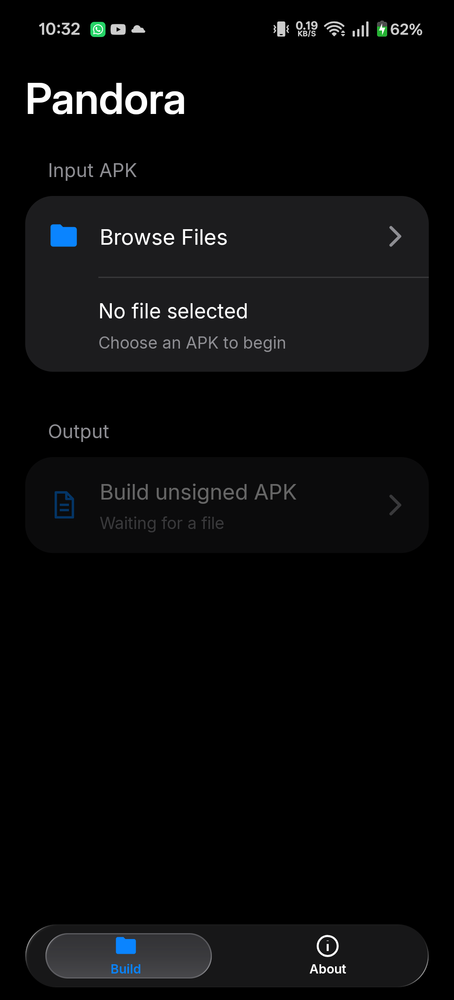
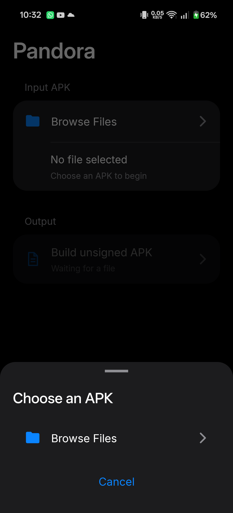
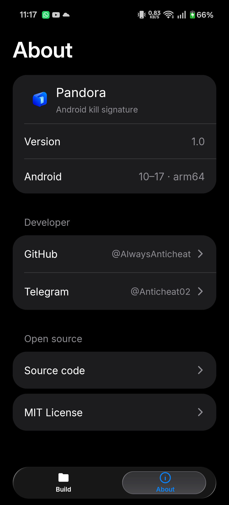

<p align="center"></p>

# Pandora — Android Kill Signature

[](https://github.com/AlwaysAnticheat/Pandora/actions/workflows/android.yml)

Pandora is an open-source Android **kill-signature** tool for arm64-v8a APKs on
Android 10 through 17. It targets file-based APK signature verification and
self-integrity checks by embedding the original APK, injecting a native core,
and redirecting the app's own APK file reads to that embedded original. The app
exports an unsigned patched APK.

Pandora is a kill-signature patcher, not a general-purpose APK builder. This
technique targets apps that inspect or hash their own APK file. Android's
package manager continues to report the installed app's actual signer, and
Android verifies an APK's signature before installation. The app prepares the
patched file and leaves signing to the user.
[Android APK signing](https://source.android.com/docs/security/features/apksigning),
[SigningInfo](https://developer.android.com/reference/android/content/pm/SigningInfo).

The Android interface uses a dark, grouped layout with a compact animated glass
tab bar. It provides recent file choices, a document picker, build status, and
an About tab with developer links.

## Screenshots

| Build | File selection | About |
| --- | --- | --- |
|  |  |  |

These screenshots were captured from the app on an Android 16 arm64 device.

## Project layout

| Module | Purpose |
| --- | --- |
| `pandora/` | Installable Android app, file UI, APK transformation, release signing |
| `pandora-core/` | Java bootstrap, C++23 core, JNI bridge, unsigned payload APK |
| `pandora-slim/` | Shared slim-embed container (byte-exact APK rebuild without size doubling) |

The Android app embeds the unsigned `pandora-core` APK as a generated asset. The
payload supplies DEX files and `libpandora-core.so` when the user builds an
output APK.

## Build

Install Android SDK API 37, NDK 30.0.16248370, JDK 17, and a Gradle-compatible
Android build environment. Set the SDK path in `local.properties` or through
the standard Android SDK environment variable.

```sh
./gradlew :pandora:assembleRelease
```

The installable app is written to
`pandora/build/outputs/apk/release/pandora-release.apk`. Its release signing
settings are read from the local, ignored
`signing/main-keystore.properties`. The patched APK exported by the app is
unsigned.

The local signing properties use these keys:

```properties
storeFile=signing/pandora-main.jks
storePassword=<local password>
keyAlias=pandora_main
keyPassword=<local password>
```

The JKS and properties files stay outside Git. The repository includes the
script `tools/CreateMainKeystore.ps1` to create a new local signing identity.
Run it before a release build when working from a fresh clone.

```powershell
./tools/CreateMainKeystore.ps1 -Keytool "<jdk>/bin/keytool.exe"
```

## Releases

[GitHub Releases](https://github.com/AlwaysAnticheat/Pandora/releases) provides
the installable, signed arm64 app and its SHA-256 checksum. Each `vX.Y.Z` tag
builds the matching app version and publishes the corresponding section of
[CHANGELOG.md](CHANGELOG.md).

The release workflow uses the local signing identity through encrypted GitHub
Actions secrets named `PANDORA_KEYSTORE_BASE64`, `PANDORA_STORE_PASSWORD`,
`PANDORA_KEY_PASSWORD`, and `PANDORA_KEY_ALIAS`. The JKS and password file are
excluded from the repository. Keep a backup of the JKS and passwords to sign
future updates with the same identity.

## Kill-signature workflow

Pandora reads the input through Android's document picker. It edits the binary
manifest, appends the payload DEX files, adds the arm64 native library, embeds
the original APK, and removes obsolete ZIP signing metadata. If the input has
an `AppComponentFactory`, the payload records its class name and delegates
component creation to it.

The original APK rides as a slim container (`assets/pandora/slim.apk`) instead
of a raw copy whenever its layout allows it: entries the outer APK reproduces
byte-exactly (STORED content such as uncompressed native libraries) are not
embedded at all and are rebuilt from the outer APK at first launch, verified
against the embedded SHA-256 digest. The patcher proves the rebuild itself
before emitting, so the output APK stays close to the input size instead of
doubling. Layouts that cannot be slimmed fall back to a full copy.

At startup, `AppFactory` extracts the embedded original APK into the app's
private data directory and starts the C++ seccomp and ptrace redirector. The
native hooks intercept file operations on the installed APK path and serve the
embedded original instead. The hooks cover `openat`, `openat2`, `readlinkat`,
`fstat`, `newfstatat`, and `statx` on arm64.

The current app accepts single APK files. Split APK sets need separate
handling. A modified APK must be signed before it can be installed on Android.
The export remains unsigned as requested. The core redirects APK file access
and delegates an existing component factory. Signature queries through
`PackageManager` continue to return the patched app's installed signing
identity.

## Frequently asked questions

**What does "kill signature" mean here?** Pandora redirects reads of an app's
installed APK to an embedded copy of the original APK. This targets file-based
APK self-checks, including checks that hash or inspect the APK bytes.

**Does the patched APK keep its original signing certificate?** The embedded
original APK keeps its bytes. The exported outer APK is unsigned, and Android
reports the signer used when that outer APK is later signed and installed.

**Does it handle split APKs?** The current input flow accepts one APK file.

## Verification

`./gradlew :pandora:connectedDebugAndroidTest` runs the on-device archive test.
The transformation passed on the connected Android 16 arm64 device. A temporary
signed test output installed and launched, including an input app with an
AndroidX component factory. An enforced runtime test confirmed that reads of
the installed APK returned the embedded original's SHA-256 bytes. Device
behavior across Android 10 through 17 still needs testing. AOSP source checks
are recorded in
[AOSP-COMPATIBILITY.md](AOSP-COMPATIBILITY.md).

## Developer and license

Developer [@AlwaysAnticheat](https://github.com/AlwaysAnticheat) can be reached
on Telegram at [@Anticheat02](https://t.me/Anticheat02).

Pandora's source is released under the [MIT License](LICENSE). Dependency and
font notices are in [NOTICE.md](NOTICE.md). The interface was informed by the
presentation style of [Files Lab](https://github.com/AlwaysAnticheat/Files-Lab).
